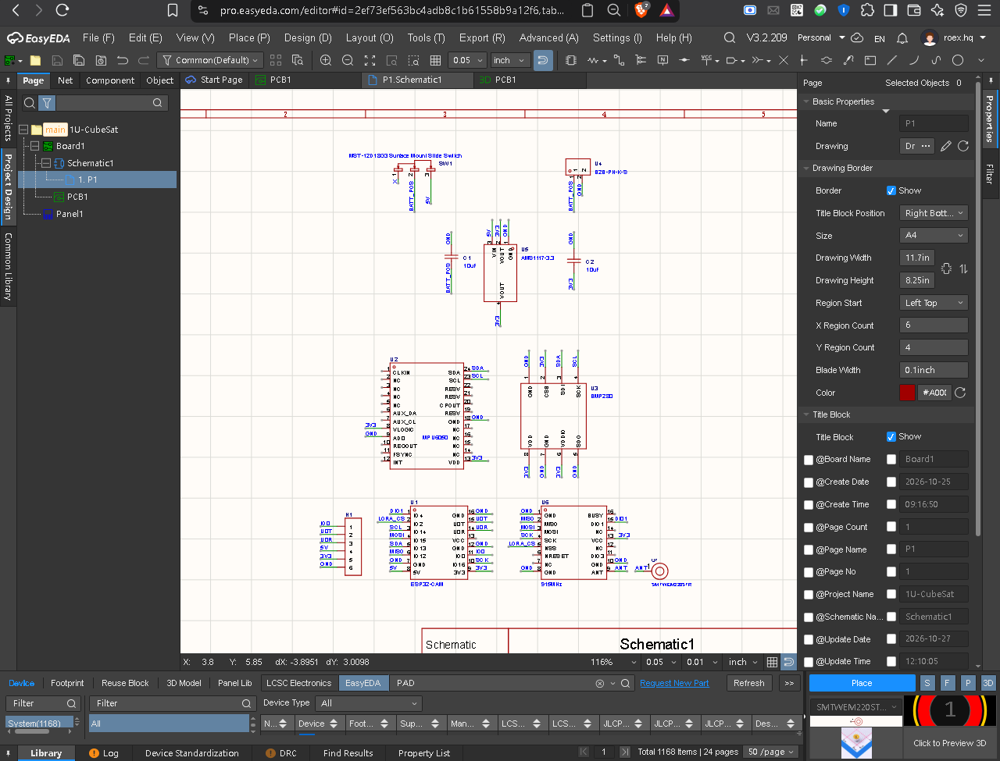
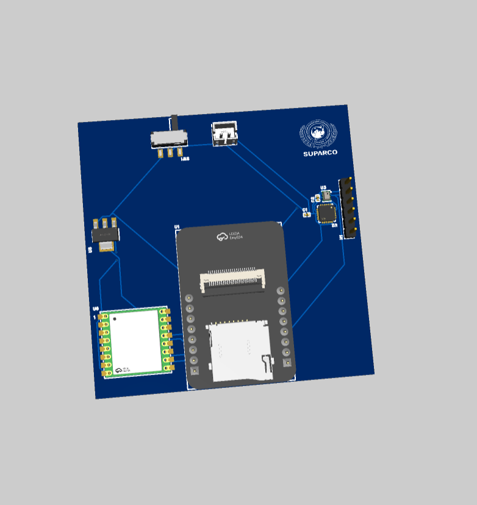
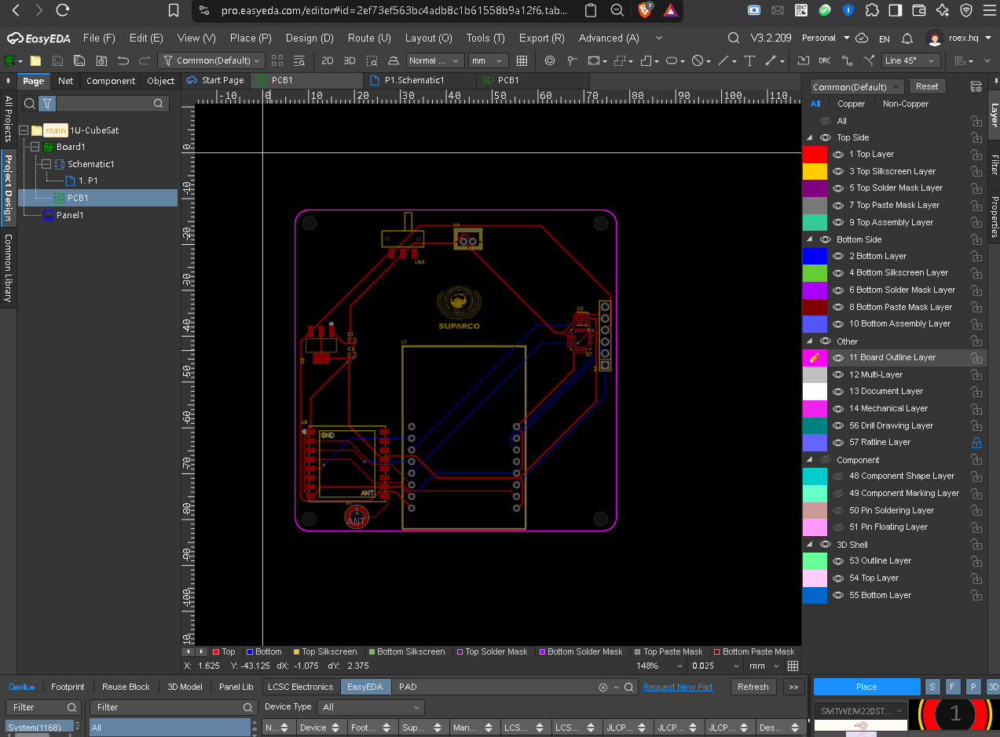
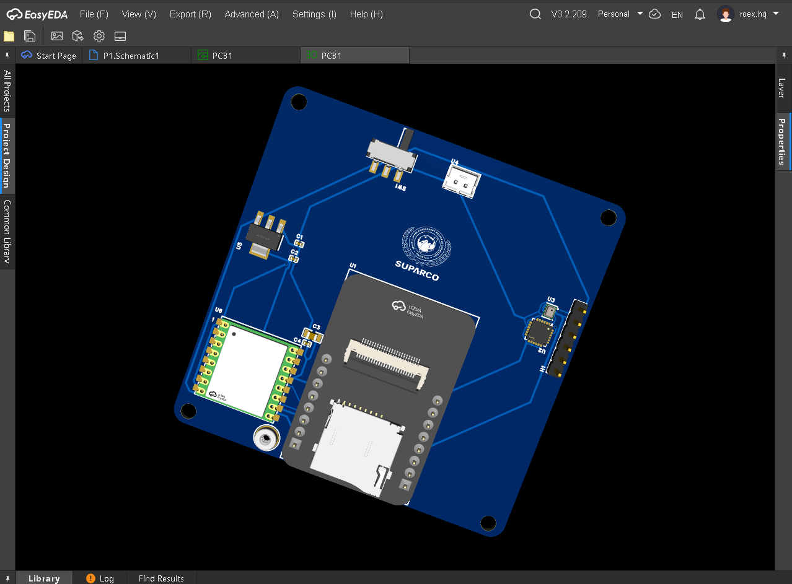

# 1U-CubeSat
1U cube sat is a small open source payload for space and enviornemental sensing. it uses an esp32 cam as the main controller, with an mpu6050 for motion, a bmp280 for pressure and temprature, and a 915MHz LoRa module with an IPEX antenna for long range communication an am117-3.3 regulator keeps power stable all packed in a 1U form factor a simple stating point for cube sat    and high altitude projects.

## 1. Schematic

## 2. Add LoRa Module

## 3. PCB Layout

## 4.3D Rendered

