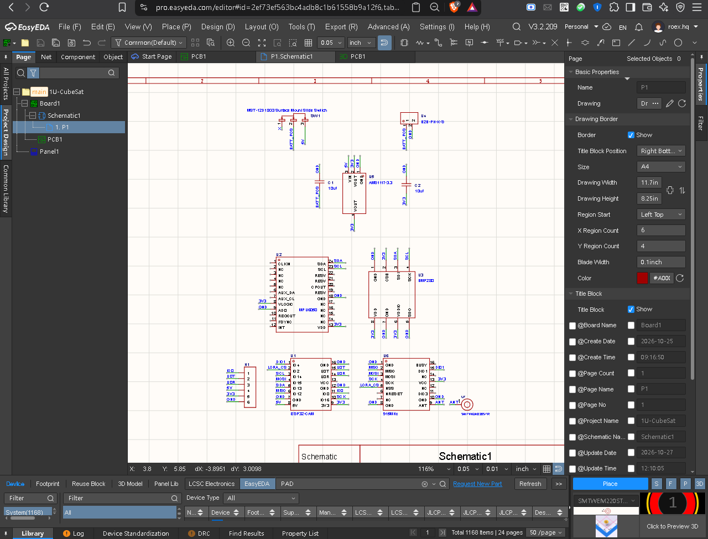
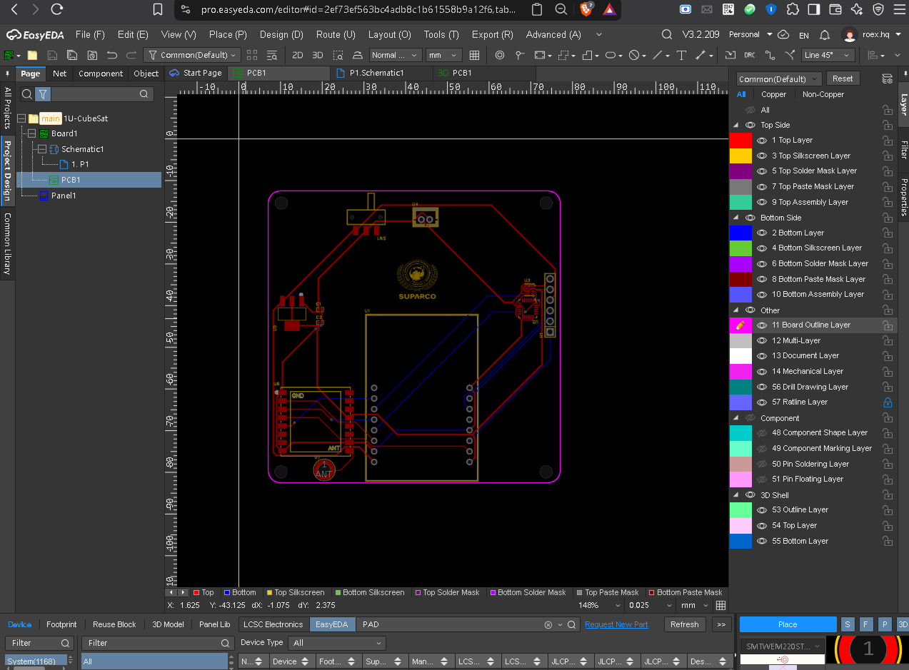
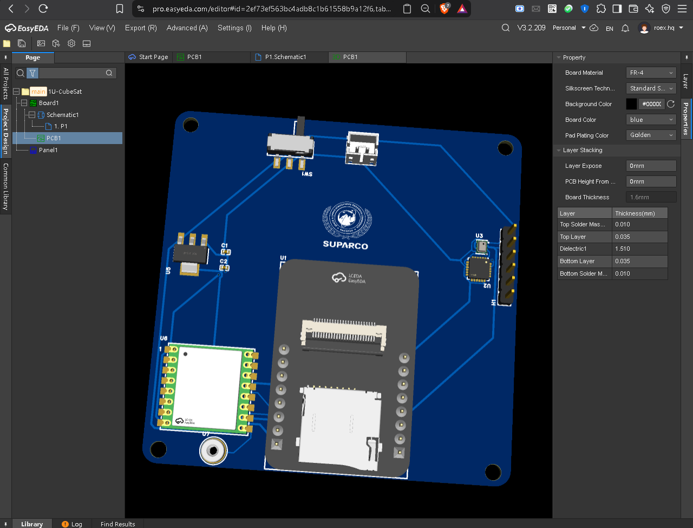

# 1U-CubeSat Telemetry Rig

title: "1U-CubeSat"
github: "https://github.com/rafay-os/1U-CubeSat"
description: "A compact custom designed 1U CubeSat telemetry and environmental sensing rig built around the esp32-cam module. Interated with an MPU6050 6 axis Imu and a BMP280 barometric pressure,temperature sensor over a robust 12c bus. Powered by a LiPo battery via an on board AMS1117-3.3V regulator and slide switch control, featuring dedicated programming headers and a professional 2-layer PCB layout branded with SUPARCO (Pakistan Space Agency)."
created_at: "2026-10-25"
total_time: "4h 30m"
---

Project Overview
The 1U-CubeSat Telemetry Rig is an open source payload for sening environment and space. It uses a small design to prototype space exploration and record data from the atmosphere. To achieve its functions it uses the ESP32-CAM microcontroller It includes an MPU6050 6-axis IMU to track motion plus a BMP280 sensor to measure barometric pressure and temperature  this project exists because I wanted to create a telemetry system that is modular and inexpensive It fits within the physical limits of a standard 1U CubeSat. The system provides wireless connectivity but also transmits data from sensors in real time.
# October 25, 2026: get my pcb.source file and BOM file
<!-- fabricate:entry 1240 -->

---
> **CAD Source & 3D Model:** Located in the `/cad/` directory (`PCB1.epro2` source & `pcb.step` 3D model).
Visual Documentation
i did not know how to get pcb source file and BOM file in easyeda because I was a beginner in using easyeda so I searched google and with the help of gemini i easily get these two files for submitting my design.

## 1. Schematic

The schematic diagram illustrates how the ESP32-CAM, MPU6050, BMP280, AMS1117 regulator and power switching circuitry connect.

## 2. Updated Schematic

Added a dedicated external antenna solder pad P1 connected to the LoRa module U6 ensuring a clear antenna keepout zone for reliable 915MHz telemetry transmission
**Total time spent: 30m**

## 3. Add LoRa Module

Added LoRa Module in my pcb for better ground connection.
# October 25, 2026 (entry 2): JUST SUBMIT MY PROJECT FOR REVIEW
<!-- fabricate:entry 1242 -->

i just added my project in reviewing i searched and placed all components in my cart, and i am very interested in to build this project when ever i will recieve my grant

## 4. PCB Layout

In this figure the top and bottom copper layout shows the routing of traces as well as the placement of decoupling capacitors. There is a specific amount of empty space around the antenna.

## 5. Updated Pcb Layout

Added and properly positioned 10uF input C1 and output C2 decoupling capacitors directly adjacent to the AMS1117-3.3V voltage regulator pins to minimize voltage spikes and high-frequency noise Increased the track widths for power `BATT_POS` `5V` `3V3` and ground nets to reduce parasitic inductance and prevent voltage drops
**Total time spent: 18m**

## 6. 3D Render

As shown in the 3D assembly render, the telemetry board contains specific parts & SUPARCO branding.
# October 26, 2026: Added LoRa moduel
<!-- fabricate:entry 1292 -->

## 7. Updated 3D Rendered

Incorporated rounded board corners with standard M3 mounting holes 3mm for seamless mechanical integration inside the 1U CubeSat frame
### Summary of Updates
## Project Journal - 1U-CubeSat Telemetry Payload

---
### Bill of Materials (BOM) & Local Procurement (epro.pk)

| No. | Quantity | Comment | Designator | Footprint | Manufacturer Part | Supplier | Price (PKR) |
|:---:|:---:|:---|:---:|:---:|:---|:---:|---:|
| 1 | 2 | 10uF | C1, C2 | C0402 | CL05A106 (SAMSUNG) | epro.pk | 20 |
| 2 | 1 | HDR-M_2.54_1x6P | H1 | HDR-TH_6P | HDR (Generic) | epro.pk | 30 |
| 3 | 1 | Slide Switch | SW1 | SW-SMD | MST-12D18G3 (SHOU HAN) | epro.pk | 50 |
| 4 | 1 | ESP32-CAM | U1 | ESP32-CAM | ESP32-CAM (Ai-Thinker) | epro.pk | 1,450 |
| 5 | 1 | MPU6050 | U2 | QFN-24 | MPU6050 (TDK/InvenSense) | epro.pk | 450 |
| 6 | 1 | BMP280 | U3 | LGA-8 | BMP280 (Bosch) | epro.pk | 480 |
| 7 | 1 | B2B-PH-K-S | U4 | CONN-TH | B2B-PH-K-S (JST) | epro.pk | 40 |
| 8 | 1 | AMS1117-3.3 | U5 | SOT-223 | AMS1117-3.3 (AMS) | epro.pk | 58 |
| 9 | 1 | 915MHz LoRa | U6 | WIRELM-SMD | LORA-CC68 (G-NiceRF) | epro.pk | 640 |
| **Total** | | | | | | | **Rs. 3,238** |
On October 26, 2026  the 1u-CubeSat telemetry payload hardware and documentation were fully finalized To resolve reviewer feedback a 915MHz LoRa module U6 was successfully integrated and routed via SPI to the esp32-cam while 10uF decoupling capacitors C1-C2 were added around the AMS1117-3.3 regulator to ensure stable power delivery The design also retained the 1x6 FTDI header for programming and maintaned clean I2C connections for the MPU6050 and BMP280 sensors Finally, the BOM was complete with local epro.pk pricing totaling PKR 3,238 and the layout successfully passed all EasyEDA DRC checks with zero errors

**Total time spent: 1h 24m**

# October 27, 2026: added antena and fix some other issues
<!-- fabricate:entry 1327 -->

this journal documents the design prototyping iteration and manufacturing preparation stages of the 1U-CubeSat Telemetry payload PCB The project began with the initial schematic design focused on core telemetry sensors and modular compatibility with standard 1U CubeSat dimensions, utilizing the esp32 cam microcontroller, MPU6050 6 axis IMU and BMP280 barometric sensor alongside an AMS1117 3.3 regulator and decoupling capacitors Next the RF subsystem integrated a 915MHz LoRa module and SMT antenna connector with proper keepout clearance to prevent signal loss During the mechanical and PCB layout phase, standard 3mm M3 mounting holes rounded board corners, and widened power traces 0.6mm 0.8mm were implemented passing the EasyEDA Design Rule Check with zero errors Finally the BOM documentation was compiled with LCSC part numbers and direct supplier links into a structured CSV format for smooth GitHub tracking and manufacturing handover

**Total time spent: 2h 18m**

# October 26, 2026: Added LoRa moduel

### Summary of Updates
# Project Journal - 1U-CubeSat Telemetry Payload

On October 26, 2026  the 1u-CubeSat telemetry payload hardware and documentation were fully finalized To resolve reviewer feedback a 915MHz LoRa module U6 was successfully integrated and routed via SPI to the esp32-cam while 10uF decoupling capacitors C1-C2 were added around the AMS1117-3.3 regulator to ensure stable power delivery The design also retained the 1x6 FTDI header for programming and maintaned clean I2C connections for the MPU6050 and BMP280 sensors Finally, the BOM was complete with local epro.pk pricing totaling PKR 3,238 and the layout successfully passed all EasyEDA DRC checks with zero errors

**Total time spent: 1h 24m**
