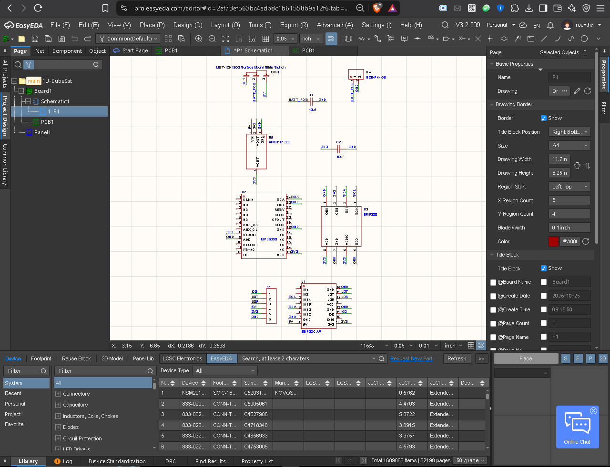
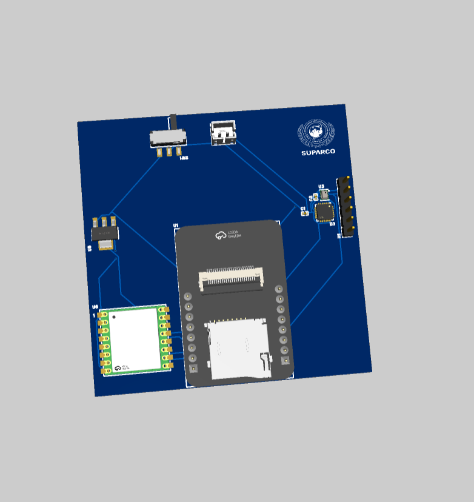

# 1U-CubeSat Telemetry Rig

Project Overview
The 1U-CubeSat Telemetry Rig is an open source payload for sening environment and space. It uses a small design to prototype space exploration and record data from the atmosphere. To achieve its functions it uses the ESP32-CAM microcontroller It includes an MPU6050 6-axis IMU to track motion plus a BMP280 sensor to measure barometric pressure and temperature  this project exists because I wanted to create a telemetry system that is modular and inexpensive It fits within the physical limits of a standard 1U CubeSat. The system provides wireless connectivity but also transmits data from sensors in real time.

---
> **CAD Source & 3D Model:** Located in the `/cad/` directory (`PCB1.epro2` source & `pcb.step` 3D model).
Visual Documentation

## 1. Schematic

The schematic diagram illustrates how the ESP32-CAM, MPU6050, BMP280, AMS1117 regulator and power switching circuitry connect.

## 2. PCB Layout

In this figure the top and bottom copper layout shows the routing of traces as well as the placement of decoupling capacitors. There is a specific amount of empty space around the antenna.

## 1. Add LoRa Module

Added LoRa Module in my pcb for better ground connection.

## 3. 3D Render

As shown in the 3D assembly render, the telemetry board contains specific parts & SUPARCO branding.

---

## Bill of Materials (BOM)

No.,Quantity,Comment,Designator,Footprint,Value,Manufacturer Part,Manufacturer,Supplier Part,Supplier,Price_PKR
1,2,10uF,"C1,C2",C0402,10uF,CL05A106,SAMSUNG,C15525,epro.pk,20
2,1,HDR-M_2.54_1x6P,H1,HDR-TH_6P,,HDR,Generic,N/A,epro.pk,30
3,1,MST-12D18G3 Slide Switch,SW1,SW-SMD,,MST-12D18G3,SHOU HAN,C49023766,epro.pk,50
4,1,ESP32-CAM,U1,ESP32-CAM,,ESP32-CAM,Ai-Thinker,C277946,epro.pk,1450
5,1,MPU6050,U2,QFN-24,,MPU6050,TDK/InvenSense,C9900042518,epro.pk,450
6,1,BMP280,U3,LGA-8,,BMP280,Bosch,C83291,epro.pk,480
7,1,B2B-PH-K-S,U4,CONN-TH,,B2B-PH-K-S,JST,C9900170324,epro.pk,40
8,1,AMS1117-3.3,U5,SOT-223,,AMS1117-3.3,AMS,C6186,epro.pk,58
9,1,915MHz LoRa,U6,WIRELM-SMD,915MHz,LORA-CC68,G-NiceRF,C5126740,epro.pk,640
