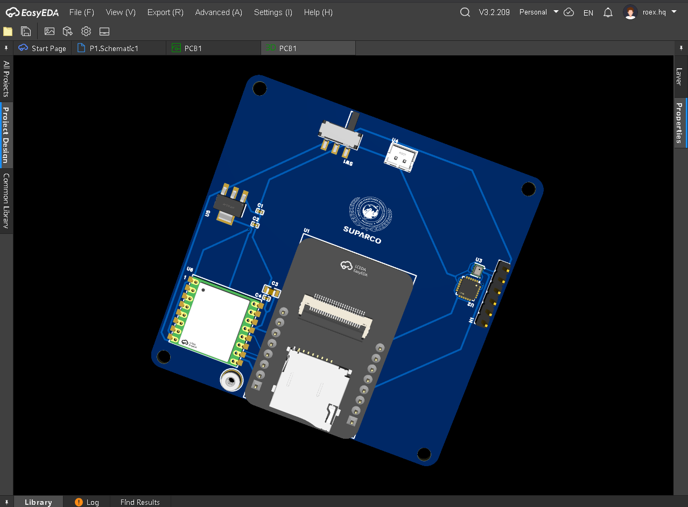

# 1U-CubeSat Telemetry Rig

Project Overview
The 1U-CubeSat Telemetry Rig is an open source payload for sening environment and space. It uses a small design to prototype space exploration and record data from the atmosphere. To achieve its functions it uses the ESP32-CAM microcontroller It includes an MPU6050 6-axis IMU to track motion plus a BMP280 sensor to measure barometric pressure and temperature.

---
> **CAD Source & 3D Model:** Located in the `/cad/` directory (`PCB1.epro2` source & `pcb.step` 3D model).
Visual Documentation. Note, that Antena module is not avalible at epro.pk so i give i take it from thriftyrcstore.com

## 1. Schematic

The schematic diagram illustrates how the ESP32-CAM, MPU6050, BMP280, AMS1117 regulator and power switching circuitry connect.

## 2. Add LoRa Module

Added LoRa Module in my pcb for better ground connection.

## 3. PCB Layout

In this figure the top and bottom copper layout shows the routing of traces as well as the placement of decoupling capacitors. There is a specific amount of empty space around the antenna.

## 4.3D Rendered

As shown in the 3D assembly render, the telemetry board contains specific parts & SUPARCO branding.
## Latest Updates
I added 100nF and 10uF decouping capacitors near the LoRa module and connected them between 3.3V and GND.I added a solid GND copper plane on the bottom layer.I moved the antenna connector closer to the LoRa ANT pin and made the feedline shorter and straighter
I ran the DRC check and no errors were reported
The antenna feedline imedance still needs to be veified using the final PCB stackup
## 1: Updated BOM CSV
## 2: Added Latest PCB render
## 3: Made Design changes
---
## Bill of Materials and Cost

The table below shows the main components used in the 1U CubeSat project and their estimated prices in Pakistani Rupees. The prices were collected from the suppliers listed in the BOM.

The total cost of the listed components is **PKR 4,564**. This amount does not include the final antenna price, PCB fabrication, assembly or shipping charges. These costs will be added after confirming the final quotes.

Some parts still need to be checked before ordering to make sure the supplier listing matches the exact component and footprint used in the PCB design.

| No. | Component | Quantity | Unit Price PKR | Total Price PKR |
|---|---|---:|---:|---:|
| 1 | 10uF Capacitor | 2 | 8 | 16 |
| 2 | 1x6 Male Header | 1 | 18 | 18 |
| 3 | Slide Switch | 1 | 15 | 15 |
| 4 | ESP32-CAM Module | 1 | 1,530 | 1,530 |
| 5 | MPU6050 Sensor | 1 | 490 | 490 |
| 6 | BMP280 Sensor | 1 | 350 | 350 |
| 7 | 2 Pin JST Connector | 1 | 280 | 280 |
| 8 | AMS1117 3.3V Regulator | 1 | 65 | 65 |
| 9 | 915MHz LoRa Module | 1 | 1,800 | 1,800 |
| 10 | IPEX Antenna Connector | 1 | To be confirmed | To be confirmed |
| 11 | PCB Fabrication | 1 | To be confirmed | To be confirmed |
| 12 | PCB Assembly | 1 | To be confirmed | To be confirmed |
| 13 | Shipping | 1 | To be confirmed | To be confirmed |

**Current component subtotal: PKR 4,564**

The final project cost will be updated after confirming the antenna price, PCB manufacturing, assembly and shipping charges.
